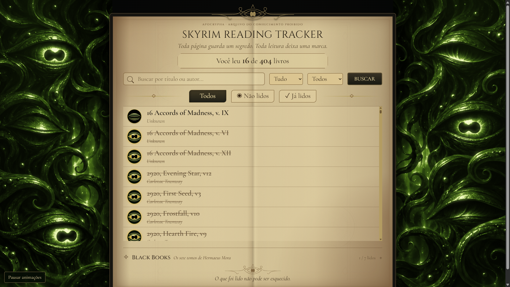

# Skyrim Reading Tracker

Um diário de leitura para acompanhar os livros encontrados em **The Elder Scrolls V: Skyrim**, com uma interface inspirada em Apocrypha e Hermaeus Mora.

O catálogo reúne **404 títulos** do jogo base e das expansões Dawnguard, Hearthfire e Dragonborn. Marque os livros que já leu, acompanhe o progresso e encontre novas leituras entre histórias, textos de lore e os sete Black Books.



## Funcionalidades

- Busca por título ou autor.
- Filtros para livros lidos e não lidos.
- Progresso de leitura salvo em banco de dados SQLite.
- Olhos interativos e texto riscado para identificar livros já lidos.
- Seção recolhível dos sete Black Books, com capas distintas e contador próprio.
- Atualização da lista sem recarregar a página ou reiniciar as animações.
- Painéis laterais animados com tentáculos e piscadas independentes.
- Visual de pergaminho envelhecido, texto em tinta preta e favicon personalizado.
- Layout adaptado para celular, navegação por teclado e opção de pausar as animações.

## Tecnologias utilizadas

| Ferramenta | Uso no projeto |
| --- | --- |
| **Python** | Regras da aplicação e integração com o banco de dados |
| **FastAPI** | Rotas HTTP, filtros e atualização do status de leitura |
| **Uvicorn** | Servidor da aplicação |
| **SQLAlchemy** | Modelos e consultas ao banco |
| **SQLite** | Persistência local do catálogo e do progresso |
| **Jinja2** | Renderização das páginas HTML |
| **HTML5 e CSS3** | Estrutura, estilo, responsividade e efeitos visuais |
| **JavaScript** | Busca, filtros e marcação de leitura sem recarregar a página |
| **Rive** | Criação e reprodução das animações laterais em arquivos `.riv` |
| **SVG** | Ícones, emblemas das capas, texturas e filtros de cor e brilho |
| **Google Fonts** | Tipografia Cinzel e Cormorant Garamond |

O frontend usa JavaScript puro, sem framework e sem etapa de build. As animações já estão exportadas; **não é necessário instalar Node.js nem o Rive CLI para executar o site**.

## Como executar

### Pré-requisitos

- Python **3.11 ou superior** — projeto validado com Python 3.14.
- Git, para clonar o repositório, ou o ZIP disponibilizado pelo GitHub.

### Instalação

Clone ou baixe o repositório e abra um terminal na pasta do projeto.

No Windows, crie o ambiente virtual e instale as dependências:

```powershell
python -m venv .venv
.\.venv\Scripts\python.exe -m pip install -r requirements.txt
```

Inicie o servidor:

```powershell
.\.venv\Scripts\python.exe -m uvicorn main:app --reload
```

No Linux ou macOS, use:

```bash
python3 -m venv .venv
.venv/bin/python -m pip install -r requirements.txt
.venv/bin/python -m uvicorn main:app --reload
```

Abra **http://127.0.0.1:8000** no navegador. A documentação das rotas fica em **http://127.0.0.1:8000/docs**.

## Banco de dados e progresso

Na primeira inicialização, a aplicação cria o arquivo `skyrim_books.db` e carrega o catálogo de `books_data.json`. As inicializações seguintes adicionam apenas os títulos ausentes, preservando os livros existentes e suas marcações.

O banco é local e **não é enviado ao GitHub**. Cada pessoa que baixar o projeto começa com seu próprio progresso. Para fazer backup da leitura, pare o servidor e guarde uma cópia de `skyrim_books.db`.

O projeto não possui login: todas as pessoas que utilizarem a mesma instância do servidor compartilham o mesmo progresso.

## Animações e acessibilidade

Os dois painéis usam o runtime web do Rive, na versão 2.49.4. O controle no canto inferior esquerdo permite ativar ou pausar as animações e salva a preferência no navegador. A preferência do sistema por movimento reduzido é respeitada até que o usuário escolha ativá-las.

Em telas pequenas, os painéis são ocultados para priorizar a leitura. Se a animação não carregar, uma imagem estática mantém a aparência do site.

O runtime Rive e as fontes são carregados pela internet. A exportação atual do Rive pode mostrar sua abertura com logo no carregamento inicial.

## Estrutura do projeto

```text
├── main.py                 # Aplicação FastAPI e rotas
├── database.py             # Conexão e sessões do SQLite
├── models.py               # Modelo dos livros
├── books_data.json         # Catálogo inicial
├── requirements.txt        # Dependências Python
├── CATALOG_SOURCES.md      # Fontes e critérios do catálogo
├── templates/
│   └── index.html          # Página principal
├── static/
│   ├── style.css           # Estilos e layout responsivo
│   ├── library.js          # Interações da biblioteca
│   ├── apocrypha.js        # Carregamento e controle das animações
│   ├── rive/               # Animações exportadas para o site
│   └── ...                 # Imagens, ícones e filtros SVG
├── docs/
│   └── preview.png         # Prévia da interface
└── tests/
    └── smoke.py            # Verificações com banco temporário em memória
```

## Verificação

Com as dependências instaladas, execute no Windows:

```powershell
.\.venv\Scripts\python.exe tests/smoke.py
```

No Linux ou macOS:

```bash
.venv/bin/python tests/smoke.py
```

A verificação cobre renderização, busca, filtros, marcação de leitura, contadores e carregamento do catálogo. Ela utiliza um banco em memória e não altera o progresso local.

## Referências

As fontes e os critérios de inclusão dos livros estão em [CATALOG_SOURCES.md](CATALOG_SOURCES.md). O catálogo não pretende reunir todas as cartas, notas, receitas e tomos de feitiços existentes no jogo.

Projeto de fã inspirado no universo de **The Elder Scrolls**, da Bethesda. As pequenas capas e os selos da interface são interpretações decorativas, não réplicas de inscrições ou capas oficiais.
